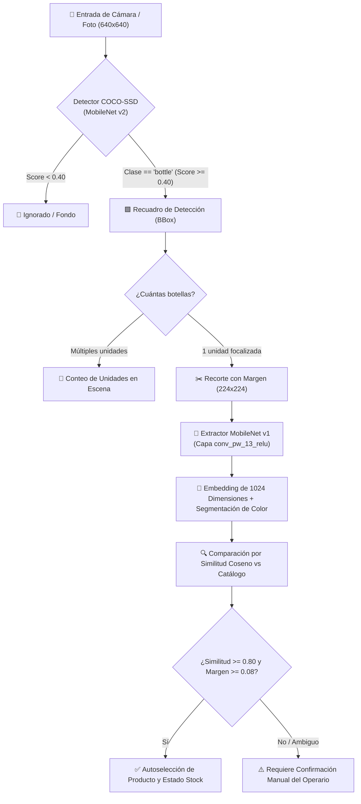
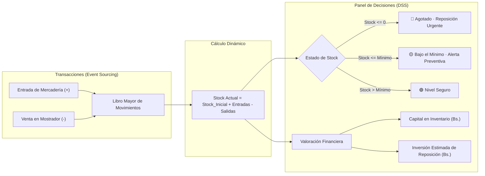

<div align="center">

# 🛒 TiendaScan DSS
### Sistema Inteligente de Control de Inventario y Soporte a la Toma de Decisiones mediante Visión Artificial

[](https://www.uagrm.edu.bo)
[](https://www.tensorflow.org/js)
[](https://github.com/tensorflow/tfjs-models)
[](https://railway.com)
[](LICENSE)

<br/>

> **TiendaScan DSS** es una solución integral orientada a tiendas de barrio y micromercados que transforma la cámara de cualquier teléfono móvil en un escáner inteligente de existencias y terminal financiero de **Soporte a la Toma de Decisiones (DSS)**, operando 100% en el navegador del cliente sin costes de infraestructura en la nube.

---

</div>

## 📌 Tabla de Contenidos
- [🎯 Visión General](#-visión-general)
- [✨ Características Principales](#-características-principales)
- [🧠 Arquitectura del Sistema](#-arquitectura-del-sistema)
  - [1. Pipeline de Visión por Computadora (2 Etapas)](#1-pipeline-de-visión-por-computadora-2-etapas)
  - [2. Motor de Soporte para la Toma de Decisiones (DSS)](#2-motor-de-soporte-para-la-toma-de-decisiones-dss)
- [📊 Fórmulas y Reglas de Decisión](#-fórmulas-y-reglas-de-decisión)
- [📂 Estructura del Proyecto](#-estructura-del-proyecto)
- [⚡ Comparativa de Eficiencia](#-comparativa-de-eficiencia)
- [🚀 Guía de Inicio Rápido](#-guía-de-inicio-rápido)
  - [Ejecución Local (Desarrollo y Pruebas Wi-Fi)](#ejecución-local-desarrollo-y-pruebas-wi-fi)
  - [Despliegue Productivo en Railway](#despliegue-productivo-en-railway)
- [👥 Información Académica y Créditos](#-información-académica-y-créditos)

---

## 🎯 Visión General

En el sector minorista de consumo masivo (*micromercados, almacenes y ventas de abarrotes*), hasta un **18% a 24% del capital de trabajo** se pierde o inmoviliza debido a desabastecimiento no detectado (*stockout*), compras desmedidas y conteo manual de inventario en papel.

Inspirado en el desafío de aula propuesto en la materia **Sistemas de Soporte para la Toma de Decisiones (UAGRM)** de llevar la clasificación de objetos a un escenario productivo, **TiendaScan DSS** resuelve este problema mediante un enfoque dual:
1. **Identificación y Conteo Automatizado**: Reconoce botellas y envases en tiempo real con la cámara.
2. **Evaluación Financiera Proactiva**: Analiza el capital inmovilizado en Bolivianos ($\text{Bs.}$), detecta quiebres de inventario y calcula los lotes de reposición óptimos al instante.

```
       CÁMARA DEL CELULAR                       SISTEMA DSS
  ┌─────────────────────────┐           ┌─────────────────────────┐
  │   Escaneo de Botella    │ ────────► │  Evaluación Financiera  │
  │   - Detección COCO-SSD  │           │  - Stock actual vs mín. │
  │   - Embeddings 1024D    │           │  - Inversión requerida  │
  └─────────────────────────┘           └─────────────────────────┘
```

---

## ✨ Características Principales

| Categoría | Capacidad | Detalle Técnico |
| :--- | :--- | :--- |
| **👁️ Visión Artificial** | **Detección Dual** | Localización de recuadros con **COCO-SSD (MobileNet v2)** e identificación de presentación con **MobileNet v1 (1024 características)**. |
| **📶 Cero Latencia** | **100% Edge Computing** | La inferencia corre dentro del navegador del operario. Las fotos **no viajan** a servidores externos, garantizando privacidad y velocidad inmediata. |
| **💵 DSS Financiero** | **KPIs en Tiempo Real** | Monitoreo continuo de **Valor de Stock ($\text{Bs.}$)**, ganancia proyectada y sugerencia de compra valorizada por lote. |
| **🛡️ Auditoría Contable** | **Event Sourcing** | El inventario no se sobreescribe como un entero volátil; se recalcula desde un libro mayor auditable con capacidad de **Deshacer**. |
| **📦 Catálogo Dinámico** | **Gestor de Referencias** | Permite agregar nuevos productos y almacenar hasta 6 fotos de referencia por producto sin reentrenar la red global. |
| **📤 Exportación Fácil** | **Formatos Abiertos** | Exportación con 1 clic a **CSV nativo para Excel** (con delimitador `;` y BOM `\uFEFF`) y **JSON integral**. |

---

## 🧠 Arquitectura del Sistema

### 1. Pipeline de Visión por Computadora (2 Etapas)



### 2. Motor de Soporte para la Toma de Decisiones (DSS)



---

## 📊 Fórmulas y Reglas de Decisión

### 1. Dinámica del Stock
El nivel de inventario del producto $i$ en el instante $t$ se determina por:
$$\text{Stock}_i(t) = \text{StockInicial}_i + \sum_{k=1}^{n} \Big( \text{Entrada}_{i,k} - \text{Salida}_{i,k} \Big)$$

### 2. Sugerencia de Reorden y Compra
Para todo producto cuyo $\text{Stock}_i \le \text{StockMinimo}_i$, el sistema activa la recomendación de pedido al distribuidor:
$$\text{UnidadesAReponer}_i = \max\Big(0, \text{StockObjetivo}_i - \text{StockActual}_i\Big)$$
$$\text{InversiónEstimada}_i = \text{UnidadesAReponer}_i \times \text{PrecioCompra}_i$$

### 3. Capital Inmovilizado y Margen de Utilidad
$$\text{ValorTotalStock} = \sum_{i \in \text{Catálogo}} \Big(\text{Stock}_i \times \text{PrecioCompra}_i\Big)$$
$$\text{MargenBrutoProyectado} = \sum_{i \in \text{Catálogo}} \Big(\text{Stock}_i \times (\text{PrecioVenta}_i - \text{PrecioCompra}_i)\Big)$$

### 4. Similitud Vectorial de Reconocimiento
La afinidad entre la captura $A$ y la referencia guardada $B$ utiliza la métrica del coseno sobre los embeddings normalizados:
$$\text{Similitud}(A, B) = \frac{A \cdot B}{\|A\| \|B\|} = \frac{\sum_{j=1}^{1024} A_j B_j}{\sqrt{\sum_{j=1}^{1024} A_j^2} \sqrt{\sum_{j=1}^{1024} B_j^2}}$$

---

## 📂 Estructura del Proyecto

```text
Botellas inventario/
├── 📄 index.html              # Interfaz de usuario semántica y accesible
├── 📄 server.py                # Servidor multihilo para Railway y entornos cloud
├── 📄 servidor_red.py          # Servidor HTTPS con certificados para pruebas Wi-Fi locales
├── 📄 Procfile                 # Descriptor de procesos para despliegue PaaS
├── 📄 railway.json             # Configuración de build con Nixpacks para Railway
├── 📄 requirements.txt         # Declaración de entorno Python estándar
├── 📄 runtime.txt              # Definición de versión: Python 3.11
├── 📄 .gitignore               # Exclusión de credenciales y temporales
├── 📁 css/
│   └── estilos.css             # Tokens CSS (variables, modo oscuro/claro, tipografía)
├── 📁 js/
│   ├── main.js                 # Coordinador principal del ciclo de vida y eventos
│   ├── inventario.js           # Núcleo DSS: libro mayor, stock, alertas y cálculos
│   ├── detector.js             # Módulo TensorFlow.js con COCO-SSD
│   ├── coincidencias.js        # Extractor MobileNet v1 y comparador coseno
│   ├── etiqueta.js             # Segmentación y análisis colorimétrico de etiquetas
│   ├── catalogo.js             # Gestión reactiva de edición de productos y fotos
│   └── ui.js                   # Renderizado del DOM, tarjetas e indicadores en Bs.
├── 📁 data/
│   └── productos.json          # Catálogo base inicial con precios y niveles objetivo
├── 📁 modelo/
│   ├── detector/               # Pesos y arquitectura local de SSD MobileNet v2
│   └── identificador/          # Pesos y configuración de extractor MobileNet v1
└── 📁 vendor/
    ├── tf.min.js               # TensorFlow.js 4.22.0 local (sin dependencia CDN)
    └── coco-ssd.min.js         # COCO-SSD 2.2.3 empaquetado localmente
```

---

## ⚡ Comparativa de Eficiencia

| Métrica | Cuaderno Tradicional | Lector de Código de Barras Físico | TiendaScan DSS |
| :--- | :---: | :---: | :---: |
| **Costo de Hardware** | Ninguno (Papel) | Alto (\$80 - \$200 USD por escáner) | **\$0 (Cualquier celular)** |
| **Velocidad de Ingreso** | Lento (~20 seg/producto) | Medio (~5 seg/producto) | **Ultrarrápido (< 2 seg/toma)** |
| **Soporte de Decisión** | Nulo (Solo registro) | Nulo (Requiere software ERP de pago) | **Incorporado y en Tiempo Real** |
| **Conectividad Requerida**| Ninguna | Conexión cableada a PC fija | **Offline o Cloud vía HTTPS** |
| **Riesgo de Error Humano**| Elevado | Bajo | **Mínimo con doble confirmación** |

---

## 🚀 Guía de Inicio Rápido

### Ejecución Local (Desarrollo y Pruebas Wi-Fi)

Para probar la cámara desde un teléfono móvil en la misma red Wi-Fi:
```powershell
# 1. En la carpeta del proyecto, ejecuta el servidor seguro:
python servidor_red.py

# 2. O haz doble clic directamente en:
iniciar_servidor_red.bat
```
*   Abre en tu celular: `https://[TU-IP-LOCAL]:8443`
*   Acepta la advertencia del certificado autofirmado (*Configuración avanzada -> Continuar*).

---

### Despliegue Productivo en Railway

El proyecto incluye soporte nativo para **Railway**:

1. Sube tu código a GitHub:
   ```bash
   git init
   git add .
   git commit -m "feat: Despliegue productivo TiendaScan DSS"
   git branch -M main
   git remote add origin https://github.com/TU_USUARIO/tiendascan-dss.git
   git push -u origin main
   ```
2. Entra a [Railway.com](https://railway.com/) y crea un nuevo proyecto: **Deploy from GitHub Repo**.
3. Selecciona tu repositorio `tiendascan-dss`.
4. En **Settings > Networking**, genera un dominio público.
5. ¡Listo! Accede a través de tu URL segura `https://tiendascan-dss.up.railway.app` desde cualquier celular en el mundo con soporte inmediato de cámara.

---

## 👥 Información Académica y Créditos

*   **Institución:** Universidad Autónoma Gabriel René Moreno (UAGRM)
*   **Facultad:** Facultad de Ingeniería en Ciencias de la Computación y Telecomunicaciones (FICCT)
*   **Materia:** Sistemas de Soporte para la Toma de Decisiones
*   **Semestre:** 2-2026
*   **Santa Cruz de la Sierra, Bolivia** 🇧🇴

---

<div align="center">
  <sub>Desarrollado con ❤️ para potenciar a los pequeños comerciantes y microempresarios.</sub>
</div>
